# 控制台（GUI）部署

本文全程在 Cloudflare 控制台网页上把 MailLink 部署到 Workers，本机不需要装 Node、pnpm 或 wrangler。做法参考 cloudflare_temp_email 的"UI 部署"：GitHub Actions 把项目构建成一个单文件 `worker.js`，在控制台的代码编辑器里上传。

- 用命令行部署（`wrangler deploy`）的步骤见 [`deploy.md`](deploy.md)。两种方式部署出来的功能一样，选一种即可。
- 截图取自 2026 年 11 月的中文控制台，之后界面可能会变。截图里的账号、子域、域名与数据库 ID 都已打码；有几张是在另一个 Worker 上截的（名称不是 `mail-link`），不影响操作。
- 截图只演示要点到哪里、填什么，没有真正提交。按本文操作时，每一步都要真正点"添加 / 部署 / 创建"。

## 0. 与命令行部署的区别

| 项目 | 命令行部署（deploy.md） | 控制台部署（本文） |
| --- | --- | --- |
| 前端页面 | Workers Static Assets 直出 `apps/web/dist` | 构建时打进 `worker.js`，由 Worker 按相同规则直出（`/api/*` 交给后端，其余路径找文件、找不到回退 `index.html`，并带上构建生成的 `_headers` 安全头） |
| 数据库迁移 | `wrangler d1 migrations apply APP_DB --remote` | 在 D1 控制台粘贴 Release 里的 SQL。同时会写入 `d1_migrations` 表，以后改用命令行也能接着用 |
| 绑定、变量、cron、域名 | 写在 `wrangler.jsonc` 里 | 在控制台逐项手动配置（见 §2 对照表） |

单文件模式与 Static Assets 在页面行为上有几处无害的差异，不影响使用：

- 带哈希的资源（`/assets/*`）缓存一年（`immutable`）。哈希随内容变化，升级后浏览器会自动拿新文件。
- 直接访问 `/index.html` 返回 200，不会像 Static Assets 那样跳转到 `/`。
- 带百分号编码的路径不做规范化，按原样匹配；找不到文件就回退 `index.html`。
- `index.html` 用 `Cache-Control: no-cache`，没有 ETag，每次都会重新下载（很小），不会返回 304。

## 1. 前提

- **Workers 付费套餐（Paid）**。登录时的 PBKDF2、HTML 清洗、邮件解析都按 Paid 的 CPU 时间设计，Free 套餐会在登录或打开邮件时超时，原因见 deploy.md §1。在"计算 → Workers 计划"里升级。
- **与 cloudflare_temp_email 在同一个 Cloudflare 账号**：要直接绑定 temp_email 的 D1 库读取邮件，而 D1 绑定不能跨账号。
- 打算使用的域名已经接入这个 Cloudflare 账号（"域名"列表里能看到）。
- 项目已推送到你自己的 GitHub 仓库。

## 2. 配置对照表

后面每一步都会用到下面这些值，`wrangler.jsonc` 里同名的配置与它们一一对应。

| 位置 | 类型 | 名称 | 值 |
| --- | --- | --- | --- |
| 设置 → 运行时 | 兼容日期 | — | `2026-11-01` |
| 设置 → 运行时 | 兼容性标志 | — | `nodejs_compat` |
| 设置 → 绑定 | D1 数据库 | `APP_DB` | 新建的 `mail-link` 库（§4） |
| 设置 → 绑定 | D1 数据库 | `MAIL_DB` | temp_email 正在使用的库（**只读**，见 §7.1） |
| 设置 → 绑定 | 速率限制器 | `RATE_LIMITER` | 命名空间 ID `1001`，限制 `10`，期间 `60 秒` |
| 设置 → 绑定 | 速率限制器 | `LINK_RATE_LIMITER` | 命名空间 ID `1002`，限制 `120`，期间 `60 秒` |
| 设置 → 变量和密钥 | 文本 | `PUBLIC_ORIGIN` | 对外访问地址，例如 `https://mail.example.com` |
| 设置 → 变量和密钥 | 密钥 | `APP_SECRET` | 至少 32 个字符的随机串，**部署后不能更换** |
| 设置 → 变量和密钥 | 密钥 | `SETUP_TOKEN` | 随机串，初始化完成后删除 |
| 设置 → 触发事件 | Cron 触发器 | — | `*/30 * * * *` 与 `17 3 * * *` 两条 |
| 域 | 自定义域 | — | 与 `PUBLIC_ORIGIN` 相同的主机名，例如 `mail.example.com` |
| 域 | Worker URL | — | 生产与预览两项都关闭 |

变量名、绑定名必须全大写、与上表完全一致。

## 3. 用 GitHub Actions 生成 worker.js

仓库自带工作流 `.github/workflows/release.yml`。它会依次执行类型检查、lint、单元测试，构建前端，最后用 `pnpm --filter worker build:single` 生成三个文件：

| 文件 | 用途 |
| --- | --- |
| `worker.js` | 单文件 Worker（前端已打包在内），在控制台"编辑代码"里上传 |
| `app-db-init.sql` | 首次部署时在 `mail-link` 库的 D1 控制台里执行一次 |
| `app-db-migrations.zip` | 每个迁移单独一个 `.sql`，升级时只执行新增的那几个（§14） |

两种触发方式：

- **发布版本（推荐）**：推送 `v` 开头的标签，构建完成后文件会附在 GitHub Releases 上。

  ```sh
  git tag v1.0.0
  git push origin v1.0.0
  ```

  之后在仓库的 Releases 页下载，或直接用固定的"最新版"地址：
  `https://github.com/<你的用户名>/<仓库名>/releases/latest/download/worker.js`（`app-db-init.sql` 同理）。

- **只想先试一下**：仓库页面 → Actions → `Release worker.js` → Run workflow。运行完成后，在这次运行页面底部的 Artifacts 里下载 `maillink-single`（解压后就是上面三个文件）。手动运行只构建、不创建 Release，哪怕运行时选的是 `v` 开头的标签也一样。

说明：

- 工作流只在 GitHub 上构建，不连接 Cloudflare，不需要配置任何 secrets。测试没通过就不会生成产物。
- `worker.js` 里不含域名、数据库 ID、密钥，这些都在运行时从控制台的配置里读取，所以同一份文件可以部署到任意账号和域名。
- 也可以在本地生成：`pnpm install && pnpm --filter web build && pnpm --filter worker build:single`，产物在 `apps/worker/dist/single/`（迁移 SQL 在其中的 `sql/` 目录）。

## 4. 创建 APP_DB 并初始化

### 4.1 创建数据库

左侧菜单"存储和数据库 → D1 SQLite 数据库"，点右上角"创建数据库"。

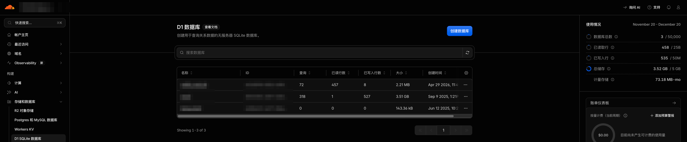

名称填 `mail-link`，数据位置保持默认，点"创建"。

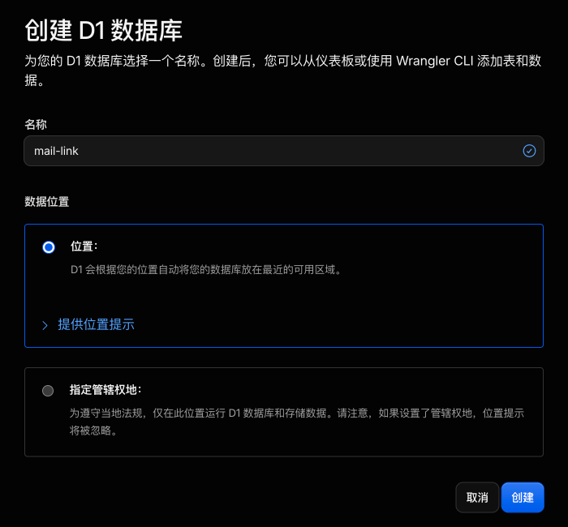

### 4.2 执行初始化 SQL

1. 打开刚建好的 `mail-link` 库，切到"控制台"标签页。
2. **先看左上角的面包屑，确认是 `mail-link`**，不是 temp_email 的库。
3. 用文本编辑器打开 `app-db-init.sql`，全选复制，粘贴到输入框，点"执行"。

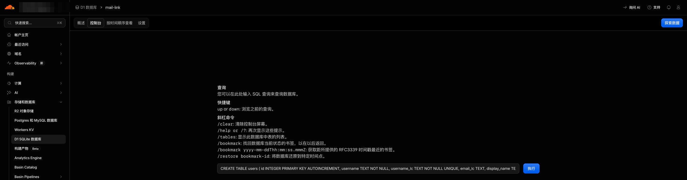

执行完后在同一个输入框里检查：

- 输入 `/tables`，应能看到 `users`、`share_links`、`rule_groups` 等表，以及 `d1_migrations`；
- 输入 `SELECT name FROM d1_migrations ORDER BY id;`，最后一行应与 `app-db-migrations.zip` 里文件名最大的那个一致。

注意：

- **只执行一次**。再执行会报 `table users already exists`。
- **粘错库时第一句就会失败**：第一句是 `CREATE TABLE users`，temp_email 的库里已经有 `users` 表，所以会报 `table users already exists`。看到这个报错时，先确认当前库是不是 `mail-link`。D1 控制台遇到错误后是否会停止执行后面的语句，没有实测过，所以不要依赖它兜底：粘贴前一定先看面包屑。
- **不要直接粘贴仓库 `apps/worker/migrations/` 下的原始文件**。控制台是单行输入框，粘贴时换行会被吞掉，原始文件里的 `--` 注释会把后面所有语句注释掉。Release 里的 SQL 已经去掉注释，并把每条语句压成一行。
- 中途报了其他错误时，先看是哪一句出错。这一步只建表、没有数据，最稳妥的做法是在库的"设置"里删掉 `mail-link`，重新创建后再执行一次。

## 5. 创建 Worker

左侧菜单"计算 → Workers 和 Pages"，点"创建应用程序"。

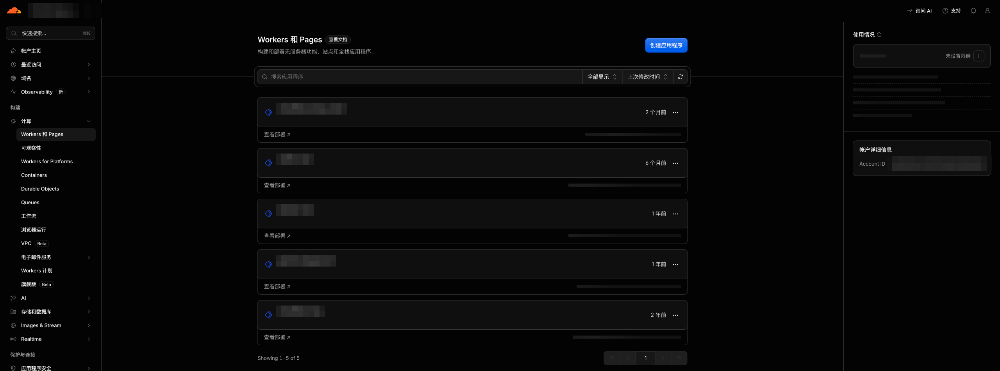

选"从 Hello World! 开始"。

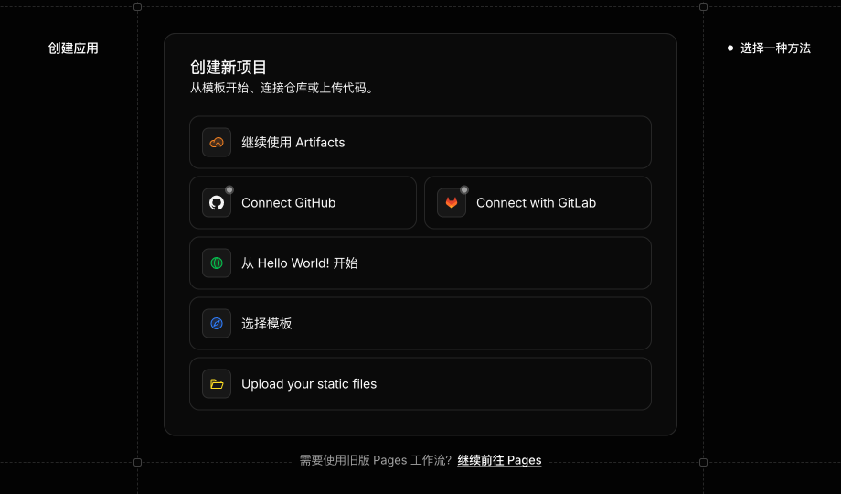

Worker name 填 `mail-link`（也可以用别的名字，它只影响 `*.workers.dev` 地址，§11 会把这个地址关掉），点"部署"。

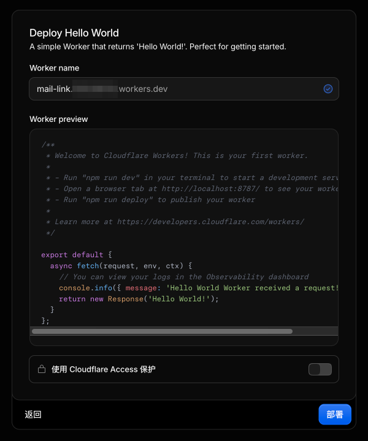

部署完成后进入这个 Worker，点顶部的"设置"标签页，§6～§9 都在这一页里操作。

## 6. 运行时

在"设置 → 运行时"里：

- 兼容日期：点日期，改成 `2026-11-01`；
- 兼容性标志：输入 `nodejs_compat` 并选中。

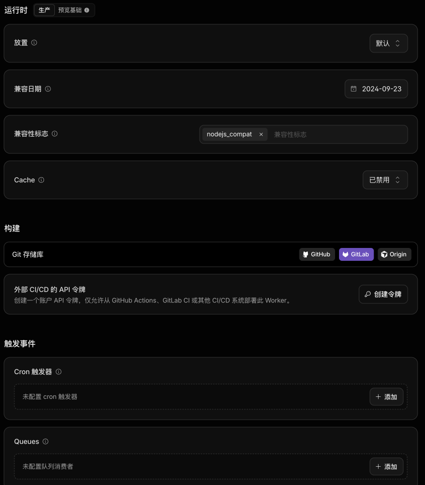

（截图是另一个 Worker 的旧值，以上面写的值为准。）

## 7. 绑定

在"设置 → 绑定"里点"添加绑定"。

### 7.1 两个 D1 数据库

左侧列表选"D1 数据库"，点"添加绑定"。

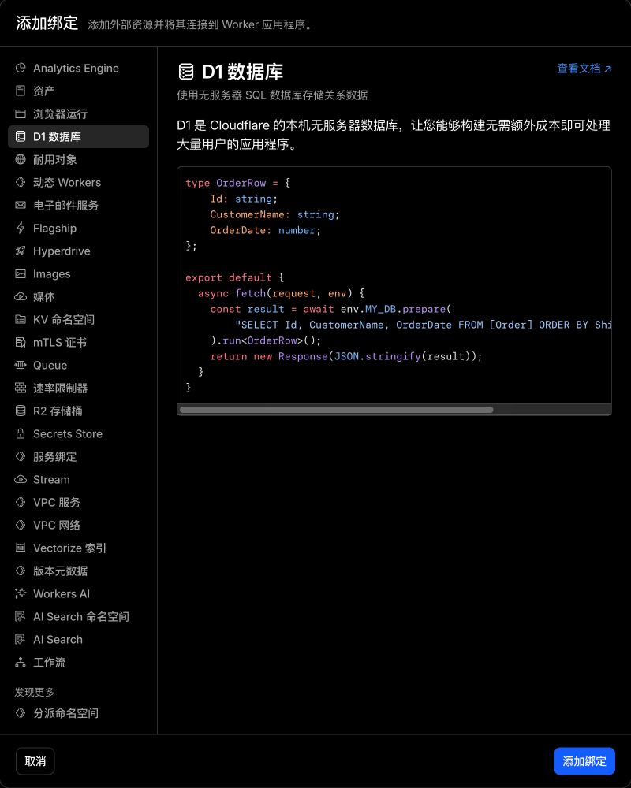

1. 变量名称 `APP_DB`，D1 数据库选 §4 建的 `mail-link`，点"添加绑定"。
2. 再添加一次：变量名称 `MAIL_DB`，D1 数据库选 **temp_email 正在使用的库**（截图里叫 `email`；不确定是哪个库时，去 temp_email 的 Worker → 设置 → 绑定里看它的 `DB` 绑的是哪个），点"添加绑定"。

"预览"一栏保持勾选"使用生产值"。

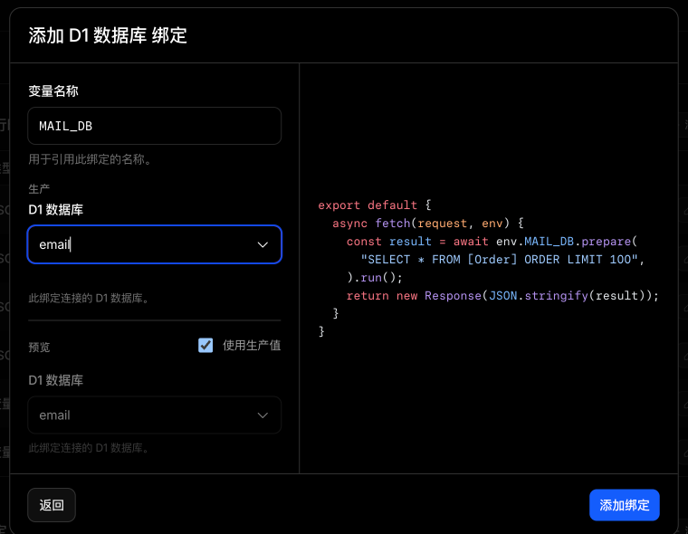

**MAIL_DB 只读**：MailLink 的代码只会读取 temp_email 的库，但 D1 没有只读绑定。不要在 temp_email 库的控制台里执行本项目的任何 SQL，也不要对它做恢复（Time Travel）操作。

### 7.2 两个速率限制器

左侧列表选"速率限制器"，点"添加绑定"。

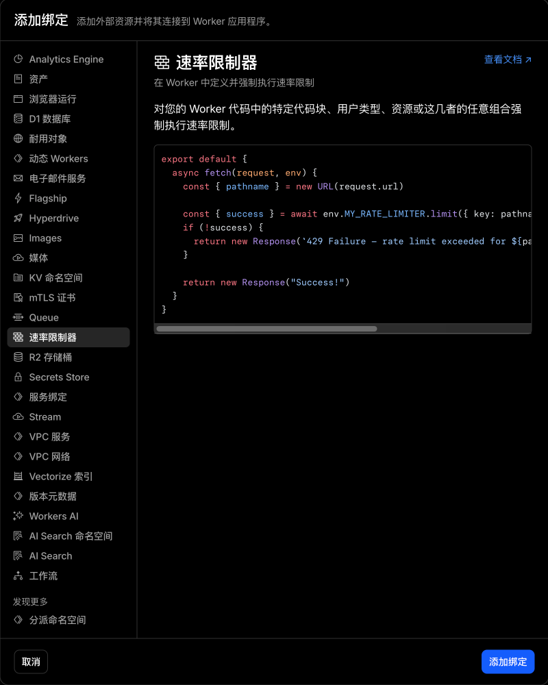

右侧面板里填写，然后点"部署"：

| 变量名称 | 命名空间 ID | 限制 | 期间 |
| --- | --- | --- | --- |
| `RATE_LIMITER` | `1001` | `10` | `60 秒` |
| `LINK_RATE_LIMITER` | `1002` | `120` | `60 秒` |

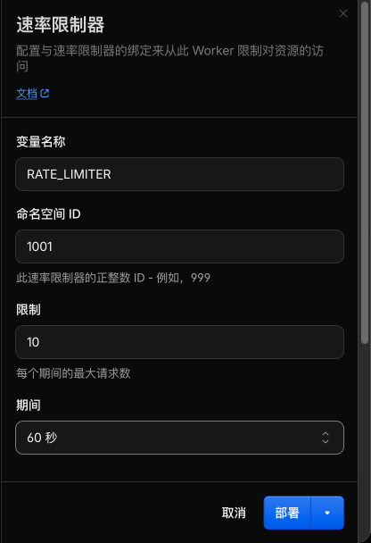

- 命名空间 ID 在整个账号内必须唯一。如果 temp_email 或其他 Worker 已经用了 `1001` / `1002`，就换两个没用过的正整数。
- 限制与期间必须是上表这两组，代码里的常量是按它们写的（`apps/worker/src/constants.ts` 的 `RATE_LIMITER_SETTINGS`）。
- 缺少任意一个绑定时，登录、取件等接口会返回 503 `rate_limiter_not_configured`，不会放行。

全部完成后，绑定表里应有 4 行：`APP_DB`、`MAIL_DB`、`RATE_LIMITER`、`LINK_RATE_LIMITER`。

## 8. 变量和密钥

先准备两个随机串，**先存进密码管理器再填**。有终端的话可以用下面两条命令生成；没有终端就用密码管理器的生成器，生成 48 位以上、只含字母和数字的串。

```sh
openssl rand -base64 48   # APP_SECRET
openssl rand -hex 24      # SETUP_TOKEN
```

在"设置 → 变量和密钥"里点"添加变量"，"选择环境"只勾"生产"。用"+ 添加"再加两行，一次填三项：

| 密钥（名称） | 值 | 右侧"密钥"勾选框 |
| --- | --- | --- |
| `PUBLIC_ORIGIN` | `https://mail.example.com`（换成你的域名） | 不勾 |
| `APP_SECRET` | 刚生成的主密钥 | **勾选** |
| `SETUP_TOKEN` | 刚生成的初始化令牌 | **勾选** |

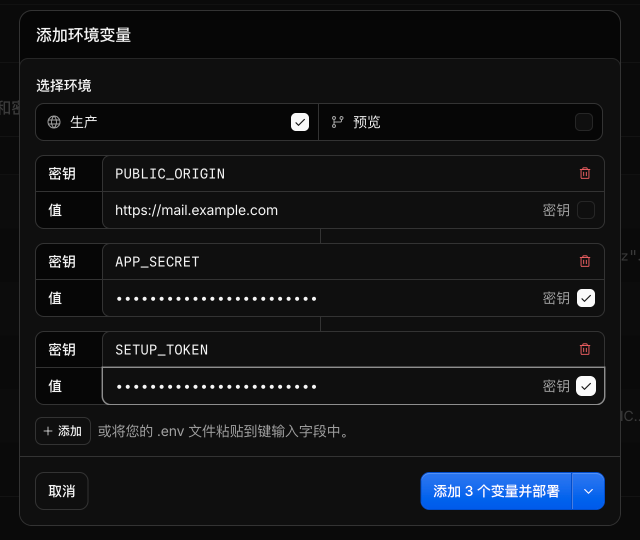

点"添加 3 个变量并部署"。

- `PUBLIC_ORIGIN` 只写协议加主机名，不带路径，也不带结尾的 `/`。写操作的 CSRF 校验、通行密钥、OAuth 回调和 Turnstile 都以它为准，所以必须与 §11 绑定的域名一致。**更换域名会让已注册的通行密钥全部失效**，上线前定好。
- `APP_SECRET` 至少 32 个字符，**部署后不能更换**：换了以后，所有密码无法验证，两步验证与第三方密钥无法解密，取件链接也无法再导出。勾选"密钥"后控制台不再显示它的值，所以务必另外保存一份。详见 deploy.md §3.2。
- 只勾选"生产"环境即可。

## 9. Cron 触发器

在"设置 → 触发事件 → Cron 触发器"里点"添加"，切到"Cron 表达式"标签页：

1. 填 `*/30 * * * *`（每 30 分钟触发一次后台预热；是否运行、隔多久运行在管理端"系统设置 → 后台预热"里设置，默认关闭），点"添加"；
2. 再添加一条 `17 3 * * *`（每天 UTC 03:17 清理过期数据）。

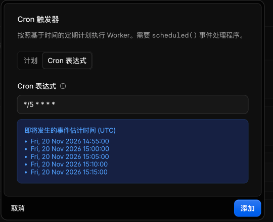

## 10. 上传 worker.js

1. 在 Worker 页面右上角点"编辑代码"，进入在线编辑器。
2. 点左侧的 Explorer 图标，在文件列表里删除原来的 `worker.js`（右键 → Delete）。
3. 在文件列表的空白处点右键 → `Upload...`，选择 §3 下载的 `worker.js`。也可以把文件直接拖进文件列表。
4. 确认文件列表里只有一个位于根目录的 `worker.js`，然后点右上角的"部署"。

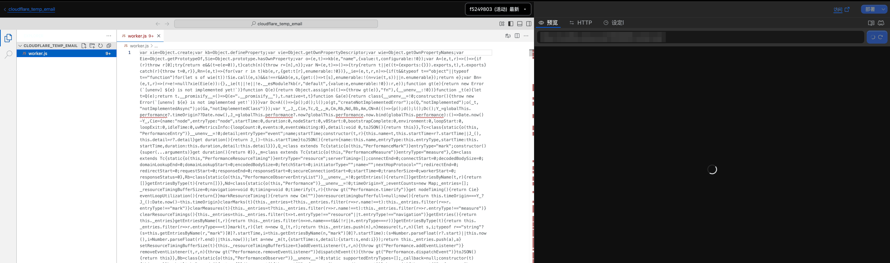

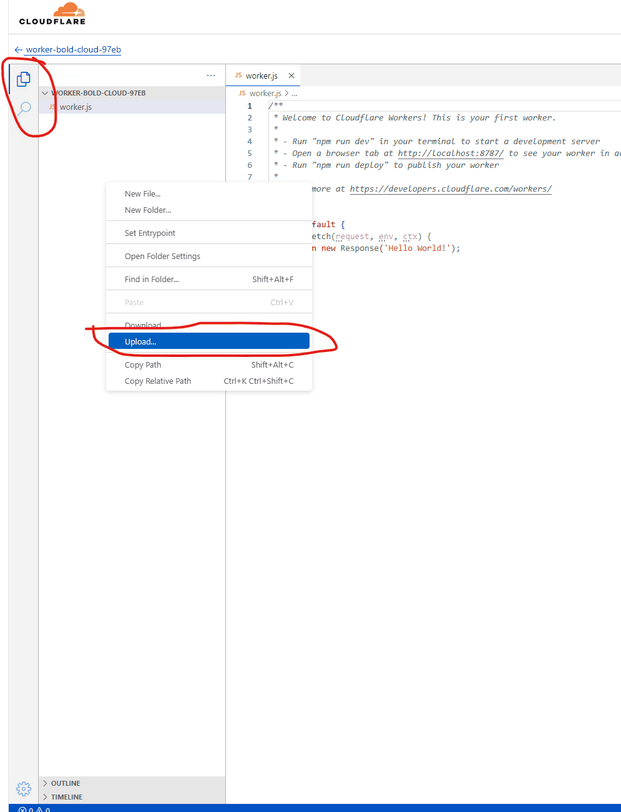

（右键菜单这张图取自 cloudflare_temp_email 的部署文档，编辑器界面相同。）

- 文件有 3 MB 多，编辑器打开和保存要等几秒；左侧和底部可能显示很多 lint 警告，那是压缩后的代码，不影响部署。
- 不要在编辑器里手动新建 `\worker.js` 这类带反斜杠的路径。如果保存时报 `No file system handle registered`，回到文件列表，右键重新上传根目录下的 `worker.js`。
- 以后升级也是同样的操作：上传新的 `worker.js` 覆盖旧文件，然后点"部署"。

## 11. 自定义域名，关闭 workers.dev

切到 Worker 顶部的"域"标签页：

1. 在"自定义域和路由"里点"添加域名"，输入与 `PUBLIC_ORIGIN` 相同的主机名（例如 `mail.example.com`），按提示连接。这个域名必须已经接入当前账号。
2. 等新域名能打开后，把上方"Worker URL"里"生产"和"预览"两个开关都关掉。`*.workers.dev` 地址和 `PUBLIC_ORIGIN` 不一致，在那里写操作会被 CSRF 校验拒绝，通行密钥和 Turnstile 也用不了，留着只会多一个入口。另外，`workers.dev` 在中国大陆无法访问。

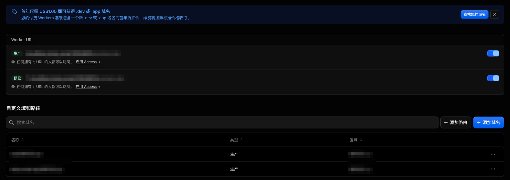

另外，在该域名的 zone 设置里关掉 Rocket Loader、Web Analytics 自动注入、Email Address Obfuscation 等会改写 HTML 的功能，否则页面 CSP 会拦掉它们注入的脚本，详见 deploy.md §4 最后一条。

## 12. 首次初始化

浏览器打开 `https://<你的域名>/setup`，填管理员用户名、密码（至少 10 个字符）与 §8 的 `SETUP_TOKEN`，点"创建管理员"。

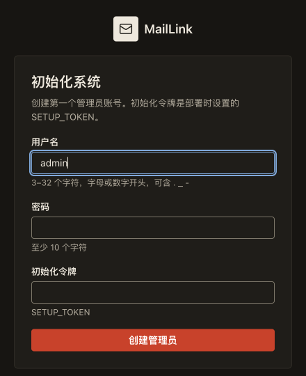

之后：

1. 回到"设置 → 变量和密钥"，删除 `SETUP_TOKEN`。
2. 用管理员账号登录，在"账号安全"里启用两步验证，建议同时登记一把通行密钥。

## 13. 部署后检查

逐项核对 deploy.md §6 的冒烟检查清单，其中命令行操作在控制台里的对应位置是：

- 看日志（代替 `wrangler tail`）：Worker → Observability；
- 健康检查：登录管理员后，在浏览器里打开 `https://<你的域名>/api/admin/system/health`，`mail_db.probe.healthy` 应为 `true`，`rate_limit.configured` 与 `rate_limit.link_configured` 都应为 `true`；
- cron：后台预热默认关闭，此时 `cron.prewarm` 为 `null` 是正常的。要验证的话，先在"系统设置 → 后台预热"里打开，过了下一个整点或半点再看同一个健康检查接口，`cron.prewarm` 里应有上次运行时间且没有错误；
- 初始化入口已关闭：打开 `https://<你的域名>/api/setup/status` 应返回 `"needs_setup":false`，`POST /api/setup` 返回 404。这只说明初始化已经完成（该接口只看 `users` 表），**不能**证明 `SETUP_TOKEN` 已删除；确认删除要在"设置 → 变量和密钥"里看列表，其中不应再有 `SETUP_TOKEN`。

## 14. 升级

1. 看新版本 Release 的说明，下载新的 `worker.js` 与 `app-db-migrations.zip`。
2. **先迁移**：打开 `mail-link` 库的控制台，**先看页面顶部的面包屑 / 库名，确认是 `mail-link`**，不是 temp_email 的库。执行 `SELECT name FROM d1_migrations ORDER BY id;`，与 zip 里的文件名对比。没有出现在结果里的，按文件名从小到大逐个打开、复制、粘贴、执行。每个文件末尾都带着自己的 `d1_migrations` 记录，执行一次就会被记为"已执行"。

   每个单独迁移文件的第一句是 `SELECT username_lc FROM users LIMIT 0;`。`username_lc` 只有 `mail-link` 的 `users` 表才有，粘到 temp_email 的库里这句会报 `no such column: username_lc`，后面的语句不应再执行。这只是兜底：D1 控制台遇到错误后是否会停止执行后面的语句没有实测过（本地 D1 用 `--file` 执行时整个文件是一个事务，错误会整体回滚，但控制台不一定相同），所以仍以执行前确认库名为准。看到这个报错，先确认当前库是不是 `mail-link`。`app-db-init.sql` 没有这句探测（全新库里 `users` 还不存在），它靠首句 `CREATE TABLE users` 在 temp_email 的库上失败。
3. **再更新代码**：按 §10 上传新的 `worker.js` 并部署。

迁移只会加表、加列、加索引，所以先迁移再换代码不会影响正在运行的旧版本。

回滚代码：在 Worker 的"部署"标签页里选一个旧版本重新部署。迁移不会回退，旧代码可以在已迁移的库上运行。需要恢复数据时，用 `mail-link` 库控制台的 `/bookmark` 与 `/restore` 命令（D1 Time Travel，见 deploy.md §10），**只对 `mail-link` 库操作**。

## 15. 常见问题

| 现象 | 原因与处理 |
| --- | --- |
| 打开域名只显示 `Hello World!` | `worker.js` 没有上传，或者上传后没有点"部署"（§10） |
| 登录、注册或取件返回 503 `rate_limiter_not_configured` | 速率限制器绑定缺失，或变量名称不对（§7.2） |
| 登录、保存等写操作返回 403 `csrf_origin_mismatch` | 浏览器访问的地址与 `PUBLIC_ORIGIN` 不一致，比如用 `*.workers.dev` 访问，或者 `PUBLIC_ORIGIN` 末尾多了 `/`（§8、§11） |
| 初始化或登录返回 500，Observability 里出现 `APP_SECRET 未配置或长度不足` | `APP_SECRET` 没有添加，或不足 32 个字符（§8） |
| 邮件相关页面返回 503 `mail_db_unhealthy` | `MAIL_DB` 绑错了库，或 temp_email 的表结构不符合要求；看健康检查里的 `mail_db` 字段（§13） |
| 页面打不开，Observability 里出现 `no such table` | `mail-link` 库没有执行 `app-db-init.sql`，或者 `APP_DB` 绑错了库（§4.2、§7.1） |
| D1 控制台报 `table users already exists` | 初始化 SQL 粘到了 temp_email 的库，或者 `mail-link` 已经初始化过（§4.2） |
| 升级时 D1 控制台报 `no such column: username_lc` | 迁移 SQL 粘到了 temp_email 的库，不是 `mail-link`（§14） |
| D1 控制台报语法错误 | 粘贴的是仓库里的原始迁移文件，换成 Release 里的 SQL（§4.2） |
| 登录或打开邮件时偶尔报 CPU 超时（Exceeded CPU Limit） | 账号是 Free 套餐，需要升级到 Workers Paid（§1） |
| 页面控制台出现 `Content-Security-Policy` 报错，来源是 `rocket-loader`、`cloudflareinsights` 等 | zone 的功能往页面里注入了脚本，按 §11 最后一段关掉 |

## 16. 以后改用命令行部署

`d1_migrations` 里已经记录了执行过的迁移，可以直接改用 deploy.md 的方式：把真实的数据库 ID、域名路由、速率限制器命名空间写进 `wrangler.jsonc`，然后执行 `wrangler d1 migrations apply APP_DB --remote`，它只会执行还没记录的迁移。注意 `wrangler deploy` 会用 `wrangler.jsonc` 里的绑定和变量覆盖控制台里的配置，切换前先把配置文件填完整。`APP_SECRET`、`SETUP_TOKEN` 这类密钥不受影响。
